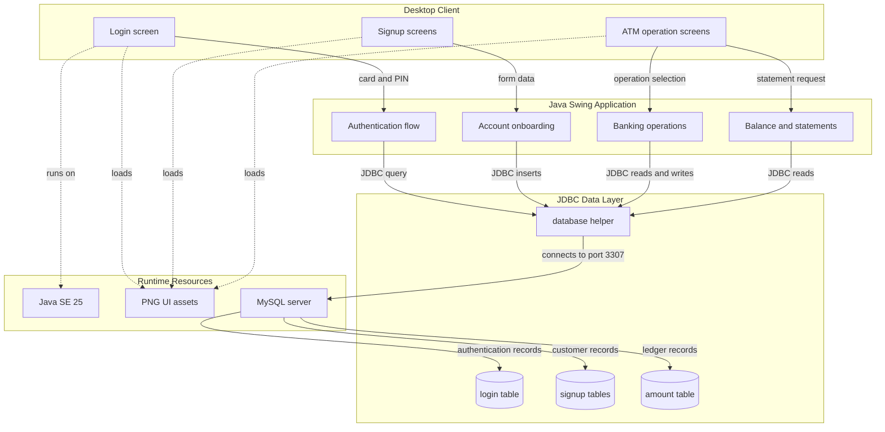
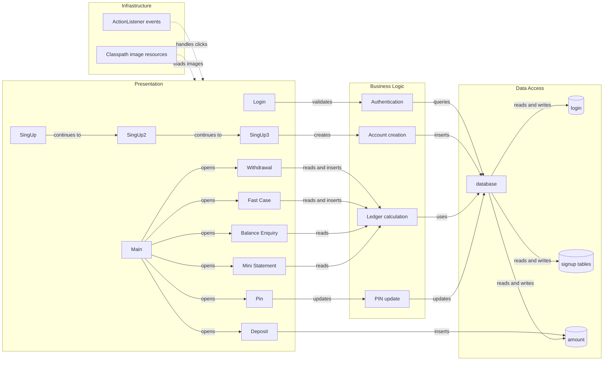

# Architecture Diagram

यह document Bank Management System के वर्तमान Java Swing desktop architecture और उसके component relationships को दिखाता है। Diagram source code में मौजूद screens, JDBC helper, MySQL tables और resource flow पर आधारित है।

## Application Architecture

<!-- mermaid-checked: no \n, no em-dash/en-dash, no {} in labels, subgraphs are id["label"], arrows are -->|"label"|, all subgraphs closed by end, ids unique -->

### Technology Stack Summary

| Layer | Technology | Version | Purpose |
|---|---|---|---|
| Language | Java | Java SE 25 configured | Application implementation |
| Presentation | Swing and AWT | JDK APIs | Desktop UI and event handling |
| Database access | JDBC | MySQL Connector/J 26.7.0 configured | SQL execution |
| Database | MySQL | Local instance | Authentication and banking data |
| Date input | JCalendar | 1.4 | Date of birth selection |
| Build environment | Eclipse project | `.project` and `.classpath` | Source and output management |

### Data Storage & External Services

Application local MySQL server के `bank` database से JDBC के माध्यम से जुड़ती है। `login` table authentication के लिए, `signup`, `signuptwo` और `signupthree` customer onboarding के लिए और `amount` transaction ledger के लिए उपयोग होते हैं। कोई external web API, message broker या cloud service source code में दिखाई नहीं देती; PNG files classpath resources के रूप में local application से load होती हैं।

### Key Architectural Decisions

- सभी screens event-driven Swing `JFrame` और `ActionListener` pattern पर आधारित हैं।
- Database operations को `database` helper के माध्यम से एक common JDBC entry point दिया गया है।
- Current balance को stored field के बजाय `amount` transaction history से runtime पर calculate किया जाता है।

## Component Relationships

<!-- mermaid-checked: no \n, no em-dash/en-dash, no {} in labels, subgraphs are id["label"], arrows are -->|"label"|, all subgraphs closed by end, ids unique -->

### Component Inventory

| Component | Layer | Type | Responsibility |
|---|---|---|---|
| `Login` | Presentation | Swing `JFrame` | Card number और PIN लेकर authentication शुरू करता है |
| `SingUp` | Presentation | Swing form | Personal details collect और save करता है |
| `SingUp2` | Presentation | Swing form | Additional KYC details collect करता है |
| `SingUp3` | Presentation | Swing form | Account type, services, card number और PIN setup करता है |
| `Main` | Presentation | ATM menu | Banking operation screens के बीच navigation देता है |
| `Deposit` | Presentation and logic | Transaction screen | Deposit transaction insert करता है |
| `Withdrawal` | Presentation and logic | Transaction screen | Balance check करके withdrawal insert करता है |
| `Fast_Case` | Presentation and logic | Quick transaction screen | Predefined withdrawal amount process करता है |
| `Balance_Enquriy` | Presentation and logic | Inquiry screen | Net balance calculate और display करता है |
| `Mini_Statement` | Presentation and logic | Statement screen | Account details और transaction history display करता है |
| `Pin` | Presentation and logic | Update screen | PIN-related tables में नया PIN update करता है |
| `database` | Data access | JDBC helper | MySQL connection और SQL `Statement` provide करता है |
| `login` | Data storage | MySQL table | Card number और PIN based login records रखता है |
| `signup` | Data storage | MySQL table | Personal customer details रखता है |
| `signuptwo` | Data storage | MySQL table | Additional customer details रखता है |
| `signupthree` | Data storage | MySQL table | Account, card, PIN और requested services रखता है |
| `amount` | Data storage | MySQL table | Deposit और withdrawal entries रखता है |
| `ActionListener` | Infrastructure | Event mechanism | Button click events को संबंधित screen logic तक पहुंचाता है |
| `ClassLoader` resources | Infrastructure | Resource loading | ATM, background और logo images load करता है |

