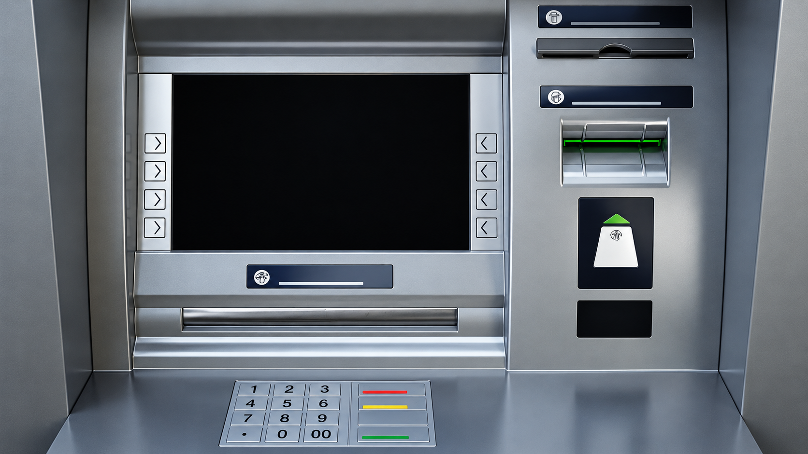
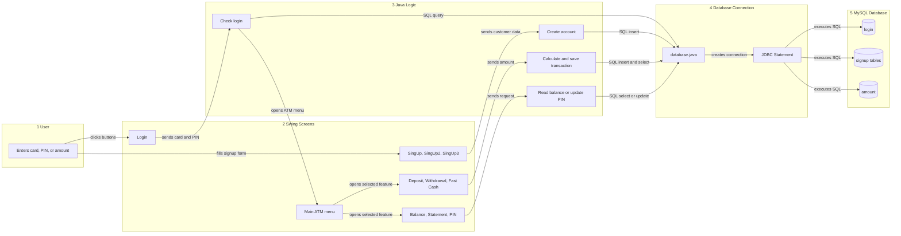
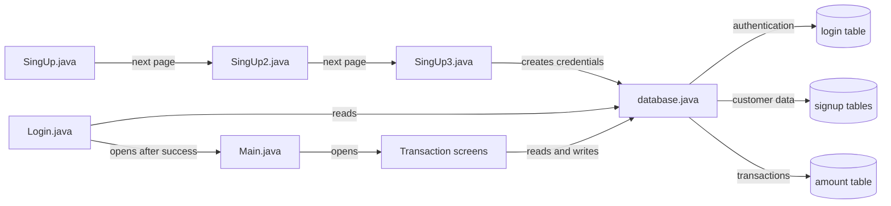

# Bank Management System

The **Bank Management System** is a Java Swing desktop application that simulates common ATM and banking operations. It provides card/PIN login, customer registration, deposits, withdrawals, fast cash, balance enquiry, mini statements, and PIN change functionality.

This README explains the project in English, including its architecture, user flow, database design, source structure, and the visual assets used by the application.

## Visual Overview

### Application Background

The login screen uses the following banking-themed background image:


### ATM Operation Background

The transaction screens use the ATM image below as their full-screen background:



### Bank Logo

The signup screens display the bank logo:


> These images are loaded at runtime from the classpath using `ClassLoader.getSystemResource("Icon/...")`.

## Main Features

- Login with card number and PIN
- Three-step customer account registration
- Deposit money
- Normal cash withdrawal
- Fast cash withdrawal using predefined amounts
- Balance enquiry
- Mini statement
- PIN change
- MySQL storage for customer, login, and transaction data
- Swing-based desktop user interface with ATM and bank images

## Technology Stack

| Layer | Technology | Purpose |
|---|---|---|
| Programming language | Java | Application implementation |
| User interface | Java Swing and AWT | Windows, forms, labels, text fields, and buttons |
| Database connectivity | JDBC | Connects Java to MySQL |
| Database | MySQL | Stores customer, login, and transaction records |
| Calendar control | JCalendar 1.4 | Date of birth selection |
| Project format | Eclipse Java project | Source and compiled output management |
| Configured runtime | Java SE 25 | Java runtime configured in `.classpath` |

## Project Structure

```text
Bank_Management_System/
├── src/
│   ├── Icon/
│   │   ├── atm.png
│   │   ├── bg.png
│   │   └── logo.png
│   └── mypack/
│       ├── Login.java
│       ├── Main.java
│       ├── SingUp.java
│       ├── SingUp2.java
│       ├── SingUp3.java
│       ├── Deposit.java
│       ├── Withdrawal.java
│       ├── Fast_Case.java
│       ├── Balance_Enquriy.java
│       ├── Mini_Statement.java
│       ├── Pin.java
│       └── database.java
├── bin/                 # Eclipse compiled .class files
├── .classpath
└── .project
```

## Application Architecture

### The Simple Idea

The application has four easy-to-understand parts:

1. **Screens**: Java Swing windows where the user types data and clicks buttons.
2. **Application logic**: Code inside those screen classes that validates input and decides what to do.
3. **JDBC helper**: `database.java` opens the MySQL connection and provides a SQL `Statement`.
4. **MySQL database**: Stores login details, customer details, and transaction history.

There is no separate web server and no REST API. Everything runs inside one Java desktop process.

### Architecture Diagram

Read this diagram from left to right:

<!-- mermaid-checked: no \n, no em-dash/en-dash, no {} in labels, subgraphs are id["label"], arrows are -->|"label"|, all subgraphs closed by end, ids unique -->


### How to Read the Diagram

- **Step 1 to Step 2**: The user interacts with Swing screens such as `Login`, `SingUp`, `Main`, and `Deposit`.
- **Step 2 to Step 3**: The button event calls the logic written inside that screen class. For example, the Login button runs the login query.
- **Step 3 to Step 4**: The screen creates `new database()` and uses `db.statement` to send SQL.
- **Step 4 to Step 5**: JDBC sends the SQL to MySQL and returns records or saves new records.
- **Return path**: The result comes back to the screen. The screen then displays a success message, error message, balance, or statement.

### Example: Login Request

```text
User enters card number and PIN
        |
        v
Login.java reads the fields
        |
        v
database.java opens JDBC connection
        |
        v
MySQL checks the login table
        |
        v
Valid credentials -> Main.java
Invalid credentials -> Error message
```

### Example: Deposit Request

```text
User enters amount
        |
        v
Deposit.java validates the amount
        |
        v
database.java sends an INSERT query
        |
        v
MySQL saves the record in amount table
        |
        v
Success message -> Main.java
```

### Component Relationships

The following smaller diagram shows which source file is responsible for each part:

<!-- mermaid-checked: no \n, no em-dash/en-dash, no {} in labels, subgraphs are id["label"], arrows are -->|"label"|, all subgraphs closed by end, ids unique -->


## Visual User Flow

### 1. Login


1. `Login.java` opens the login window.
2. The user enters a card number and PIN.
3. The application queries the `login` table.
4. If the credentials match, `Main.java` opens the ATM menu.
5. If they do not match, an incorrect card/PIN message is displayed.

### 2. ATM Menu and Operations


After successful login, `Main.java` provides buttons for:

- **Deposit**: Opens `Deposit.java`.
- **Case Withdrawal**: Opens `Withdrawal.java`.
- **Fast Cash**: Opens `Fast_Case.java`.
- **Mini Statement**: Opens `Mini_Statement.java`.
- **Pin Change**: Opens `Pin.java`.
- **Balance Enquiry**: Opens `Balance_Enquriy.java`.
- **Exit**: Closes the application.

### 3. New Account Registration


The registration process is divided into three screens:

1. **`SingUp.java`** collects personal details such as name, gender, date of birth, email, marital status, address, city, state, and PIN code.
2. **`SingUp2.java`** collects additional information such as religion, category, income, education, occupation, PAN, Aadhaar, senior-citizen status, and existing-account status.
3. **`SingUp3.java`** collects account type and requested banking services. It generates a card number and PIN, then inserts account credentials into the database.

After registration, the generated card number and PIN are displayed and the user is taken to the deposit screen.

## Transaction Flow

### Deposit

`Deposit.java` validates the amount and inserts a `Deposit` record into the `amount` table.

### Normal Withdrawal

`Withdrawal.java` reads the user's transaction history, calculates the current balance, checks whether sufficient funds are available, and inserts a withdrawal record.

### Fast Cash

`Fast_Case.java` provides predefined amounts such as Rs. 100, Rs. 300, Rs. 500, Rs. 1,000, Rs. 2,000, Rs. 5,000, and Rs. 10,000. It checks the balance before recording the withdrawal.

### Balance Enquiry

`Balance_Enquriy.java` calculates the net balance by adding deposits and subtracting withdrawals from the `amount` table.

### Mini Statement

`Mini_Statement.java` displays the masked card number, transaction history, and calculated total balance.

### PIN Change

`Pin.java` updates the PIN in the `amount`, `login`, and `signupthree` tables, then opens the main ATM menu with the new PIN.

## Database Design

The application connects to a MySQL database named `bank` on `localhost:3307`. The following logical tables are used:

| Table | Responsibility | Typical data |
|---|---|---|
| `signup` | Personal details | Application ID, name, gender, date of birth, email, and address |
| `signuptwo` | Additional details | Religion, category, income, PAN, Aadhaar, and status fields |
| `signupthree` | Account details | Account type, card number, PIN, and requested services |
| `login` | Authentication | Application ID, card number, and PIN |
| `amount` | Transaction ledger | PIN, date, transaction type, and amount |

The balance is not stored as a separate value. It is calculated at runtime by adding deposits and subtracting withdrawals from the transaction history.

## How to Run

### Requirements

- Java Development Kit
- MySQL Server
- A `bank` database with the tables expected by the source code
- MySQL Connector/J
- JCalendar 1.4
- Eclipse or another Java IDE

### Eclipse

1. Import the project into Eclipse as an existing project.
2. Verify the Java runtime and external JAR paths in `.classpath`.
3. Start MySQL.
4. In `src/mypack/database.java`, verify the host, port, database name, username, and password for your local MySQL setup.
5. Run `src/mypack/Login.java` as a Java application.

### Command Line

On Windows, run the compiled application with the compiled classes and required libraries on the classpath:

```powershell
java -cp "bin;path\to\mysql-connector-j.jar;path\to\jcalendar-1.4.jar" mypack.Login
```

Replace the placeholder JAR paths with the actual paths on your computer.

## Architectural Decisions and Current Limitations

- All screens use event-driven Swing `JFrame` and `ActionListener` patterns.
- The `database` class provides a common JDBC entry point.
- The `amount` table acts as a transaction ledger, and the balance is calculated from its history.
- UI, business logic, and SQL access are currently combined inside screen classes.
- SQL statements are built by concatenating user input. Production code should use `PreparedStatement` and input validation.
- PIN values are stored as plain text. Production code should use secure credential handling and hashing where appropriate.
- Database credentials are hard-coded in `database.java`. They should be moved to configuration or environment variables before deployment.
- Connection and result-set resources should be closed properly, preferably with try-with-resources.

## Additional Architecture Document

The detailed architecture artifact is available at [architecture-diagram.md](.github/modernize/assessment/engines/facts/architecture-diagram.md).
